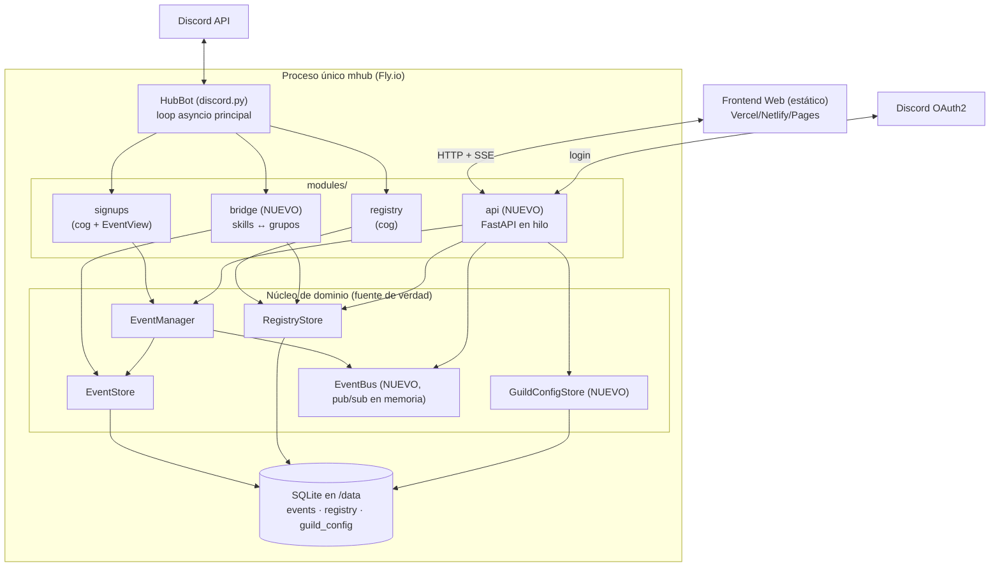
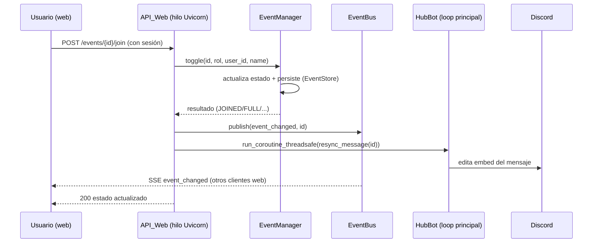

# Design Document

## Overview

Este diseño convierte `mhub` en una plataforma de doble cara (Discord + Web) sobre
una única fuente de verdad. La estrategia central es: **toda la lógica de negocio
vive en los managers/stores existentes (`EventManager`, `EventStore`,
`RegistryStore`), y tanto el bot de Discord como la API web son meras "entradas"
que invocan esa misma lógica.** No se reescribe el núcleo (`core/`): las nuevas
capacidades (configuración por servidor, puente skills↔grupos y API web) se añaden
como módulos nuevos que respetan el contrato `setup(bot)` / `restore(bot)`.

Decisiones tecnológicas principales:
- **FastAPI + Uvicorn** para la API, ejecutado en un hilo dentro del proceso del
  bot (igual que hoy corre Flask en `core/webserver.py`). Sustituye al Flask de
  health-check por una app más completa que mantiene la ruta de salud.
- **SSE (Server-Sent Events)** para el tiempo real, por simplicidad sobre
  WebSocket (la comunicación relevante es servidor→cliente).
- **Discord OAuth2** para identidad web, con sesión por cookie firmada.
- **SQLite por módulo** bajo `/data`, accedido solo a través de stores para no
  cerrar la puerta a Postgres (Req 14).

Esta sección y las siguientes citan los requisitos relevantes como (Req N).

## Architecture

### Visión de componentes



### Reto clave: dos loops/hilos coordinados

`discord.py` corre en el loop asyncio principal. Uvicorn (API) corre en un **hilo
aparte** con su propio loop. Por tanto:

- **Lectura desde la API** (consultar eventos/directorio): segura, los stores usan
  `sqlite3` con una conexión por operación; no tocan el cliente de Discord.
- **Escritura desde la API que debe reflejarse en Discord** (Req 9): la API NO
  puede llamar directamente a corutinas de discord.py desde su hilo. Se usa
  `asyncio.run_coroutine_threadsafe(coro, bot.loop)` para programar la reedición
  del mensaje en el loop del bot de forma segura entre hilos.

### Flujo de escritura web → Discord



## Components and Interfaces

### 1. Núcleo de dominio (cambios en componentes existentes)

#### EventManager (modificado)
La lógica de `toggle`, `is_complete`, etc. se conserva. Cambios:
- `create(...)` acepta una **composición** (dict de roles) en lugar de depender
  únicamente de `template_key` (Req 2).
- Tras cualquier mutación de estado, publica en el `EventBus` (Req 10).
- Calcula y persiste transiciones de `Ciclo_De_Vida` (Req 11): al completarse
  todos los roles → `completado`.

```python
def create(self, message_id, channel_id, guild_id, title, composition, *, template_key=None): ...
def toggle(self, event_id, role_key, user_id, user_name): ...  # publica en bus
def archive(self, event_id): ...                                # Req 11.3
def list_active(self, guild_id=None): ...
def list_archived(self, guild_id=None): ...
```

`composition` es la fuente para roles/plazas/emoji; `template_key` queda como
metadato opcional (de qué plantilla se originó).

#### EventBus (nuevo, en memoria)
Pub/sub mínimo para desacoplar productores (Discord y API) de consumidores (SSE).

```python
class EventBus:
    def subscribe(self) -> asyncio.Queue: ...
    def unsubscribe(self, queue): ...
    def publish(self, change: dict): ...   # no bloqueante, thread-safe
```

`publish` debe ser invocable desde el hilo de la API; internamente usa
`loop.call_soon_threadsafe` para encolar en las colas de suscriptores que viven en
el loop del bot.

#### GuildConfigStore (nuevo)
Persistencia de plantillas y categorías por servidor (Req 3).

### 2. Módulo `signups` (cambios)

- `EventView`/`build_embed` leen la **composición guardada en el evento**, no la
  plantilla global (Req 2, 15). Como los `custom_id` de los botones derivan de las
  claves de rol, esto sigue siendo compatible con vistas persistentes.
- El cog gana un comando para composición ad-hoc, p. ej.
  `/evento_custom roles:"backend:2, frontend:3, qa:1" titulo:"..."`, parseando la
  cadena a una composición y validándola (Req 2.3–2.5).
- El comando `/evento` con plantilla resuelve la plantilla vía `GuildConfigStore`
  (con fallback a `templates.json`) y copia la composición al evento (Req 2.6, 3).
- Nuevo: `/evento_archivar` (o botón para el creador) → `archive` (Req 11.3).

### 3. Módulo `registry` (cambios menores)
- Resuelve categorías vía `GuildConfigStore` con fallback a `registry.json` (Req 3).
- Sin cambios en el modelo de datos; el `provider`/`user_id` ya modela "Persona".

### 4. Módulo `bridge` (nuevo) — puente skills ↔ grupos

`modules/bridge/` con `setup(bot)`. Consume `RegistryStore` y `EventStore` vía el
bot; **no duplica lógica** (Req 4.6).

Estrategia de matching rol↔skill (Req 4.2):
- Correspondencia por **clave normalizada**: la clave del rol (p. ej. `backend`)
  se normaliza (sin tildes, minúsculas) y se busca en el directorio donde
  `norm_category == rol` o `norm_name == rol`.
- Configurable a futuro mediante un mapa de alias en `GuildConfigStore`
  (p. ej. rol `qa` → skills `testing`, `qa`). El diseño deja el punto de extensión;
  la v1 usa coincidencia directa por clave normalizada.

Interfaz:
```python
class BridgeService:
    def suggest_for_event(self, event_id) -> dict[str, list[Persona]]: ...  # Req 4.2,4.4,4.5
    def events_for_skill(self, guild_id, skill) -> list[Evento]: ...        # Req 4.3
```
- Excluye personas ya inscritas en el evento (Req 4.5).
- Si un rol no tiene candidatos, devuelve lista vacía y el cog/endpoint lo indica
  (Req 4.4).

Comandos/endpoints:
- `/equipo sugerencias evento:<id>` → muestra, por rol, candidatos del directorio.
- Endpoints API equivalentes (ver sección API).

### 5. Módulo `api` (nuevo) — API web

`modules/api/` con `setup(bot)` (arranca Uvicorn en hilo) y `restore(bot)`
(no-op o re-suscripción al bus). Guarda referencia a `bot` para acceder a managers
y al loop.

#### Arranque
```python
async def setup(bot):
    app = build_app(bot)               # inyecta managers/stores y bot.loop
    config = uvicorn.Config(app, host="0.0.0.0", port=PORT, log_level="info")
    server = uvicorn.Server(config)
    bot._api_thread = threading.Thread(target=server.run, daemon=True)
    bot._api_thread.start()
```
La ruta `/` de salud se conserva para Fly.io. El `core/webserver.py` Flask se
retira en favor de esta app (o se mantiene solo si la API está desactivada).

#### Endpoints REST

Lectura pública (sin sesión, sin `user_id`) — Req 6, 12.1:
| Método | Ruta | Descripción |
|---|---|---|
| GET | `/api/health` | Salud (para Fly.io) |
| GET | `/api/events` | Eventos activos (título, composición, ocupación/libres por rol) |
| GET | `/api/events/{id}` | Detalle de un evento |
| GET | `/api/events/archived` | Historial (Req 11.4) |
| GET | `/api/registry` | Directorio (categoría, nombre, enlace, proveedor) |
| GET | `/api/registry/search?categoria=&q=` | Búsqueda |
| GET | `/api/bridge/events/{id}/suggestions` | Sugerencias por rol (Req 4) |
| GET | `/api/stream` | SSE de cambios (Req 10) |

Autenticación — Req 7:
| Método | Ruta | Descripción |
|---|---|---|
| GET | `/auth/login` | Redirige a Discord OAuth2 authorize |
| GET | `/auth/callback` | Intercambia code, crea Sesion_Web (cookie) |
| POST | `/auth/logout` | Cierra sesión |
| GET | `/api/me` | Identidad de la sesión actual |

Escritura autenticada (requiere sesión) — Req 8, 12.2/12.3:
| Método | Ruta | Descripción |
|---|---|---|
| POST | `/api/events/{id}/join` | Apuntarse a un rol (body: `{role}`) |
| POST | `/api/events/{id}/leave` | Salir del evento |
| POST | `/api/registry` | Registrar entrada (provider/categoría/nombre/enlace) |
| DELETE | `/api/registry/{id}` | Borrar entrada propia (Req 8.4/8.5) |

La identidad (`user_id`) de toda escritura se toma **de la sesión**, nunca del
body (Req 7.4). Tras una escritura que cambie un evento, la API publica en el bus
y programa `resync_message` en el loop del bot (Req 9).

#### DTOs (excluyen datos sensibles)
```python
class RoleDTO(BaseModel):
    role: str; emoji: str | None; capacity: int; occupied: int; members: list[str]  # nombres, sin user_id
class EventDTO(BaseModel):
    id: str; title: str; status: str; created_at: str; roles: list[RoleDTO]
class EntryDTO(BaseModel):
    id: int; category: str; name: str; link: str; provider: str  # sin user_id
```
Los `user_id` se omiten en todas las respuestas públicas y en SSE no autenticado
(Req 6.3, 10.5, 12.6).

#### Sincronización web→Discord
```python
def resync_event(bot, event_id):
    fut = asyncio.run_coroutine_threadsafe(_resync(bot, event_id), bot.loop)
    # no se bloquea esperando; errores se registran (Req 9.3)
```
`_resync` localiza canal+mensaje (channel_id/message_id del evento), reconstruye
`EventView`/embed y hace `message.edit(...)`. Si no encuentra el mensaje, conserva
el cambio persistido y registra el fallo (Req 9.3).

### 6. Autenticación Discord OAuth2 (Req 7)

Flujo estándar Authorization Code:
1. `/auth/login` → redirige a `https://discord.com/oauth2/authorize` con
   `client_id`, `redirect_uri`, `scope=identify`, `state` (anti-CSRF).
2. `/auth/callback?code&state` → valida `state`, intercambia `code` por token,
   llama a `GET /users/@me`, obtiene `id` (user_id), `username`, `avatar`.
3. Crea `Sesion_Web`: cookie firmada (`itsdangerous` / SECRET de sesión) con el
   `user_id`. Cookie `HttpOnly`, `Secure`, `SameSite=Lax`.

Variables de entorno nuevas: `DISCORD_CLIENT_ID`, `DISCORD_CLIENT_SECRET`,
`OAUTH_REDIRECT_URI`, `SESSION_SECRET`, `FRONTEND_ORIGIN` (para CORS y redirección
post-login).

Dependencia de sesión en FastAPI: `Depends(get_current_identity)` que lee y
verifica la cookie; devuelve 401 si falta o es inválida (Req 7.3).

### 7. Tiempo real — SSE (Req 10)

- `GET /api/stream` mantiene la conexión y emite eventos `event_changed` con el
  estado actualizado (DTO público).
- Tanto las acciones de Discord (vía `EventManager`) como las de la API publican
  en el `EventBus`; el endpoint SSE se suscribe a una `asyncio.Queue`.
- Reconexión: el cliente, al reconectar, llama a `GET /api/events` para recuperar
  el estado vigente (Req 10.4). No se garantiza replay de eventos perdidos (diseño
  consciente, simple).
- A clientes no autenticados se les omite `user_id` (Req 10.5).

### 8. Seguridad (Req 12)
- Escritura: siempre `Depends(get_current_identity)` (Req 12.2).
- Operaciones solo sobre recursos propios: el `user_id` de la sesión se pasa a los
  stores; el borrado del directorio compara propietario (Req 8.5, 12.3).
- **Rate limiting**: middleware simple en memoria, ventana deslizante por
  (IP o identidad). Límite configurable `RATE_LIMIT_PER_MINUTE`. Caso límite=0 →
  rechaza todo con 429 (Req 12.4/12.5).
- CORS: permitir solo `FRONTEND_ORIGIN`.
- **Decisión consciente**: los endpoints `GET` de lectura son **públicos sin
  autenticación** por diseño (Req 6.4); se mitiga excluyendo `user_id` y aplicando
  rate limiting.

## Data Models

### EventStore — tabla `events` (migración)
Esquema actual: `(message_id, channel_id, guild_id, template_key, title, state_json, created_at)`.

Cambios (Req 2, 11):
```sql
ALTER TABLE events ADD COLUMN composition_json TEXT;  -- roles+plazas+emoji
ALTER TABLE events ADD COLUMN status TEXT DEFAULT 'activo';
-- created_at ya existe; se usa como fecha/hora del evento
```
Migración de eventos antiguos (Req 15.4): para filas con `composition_json` NULL,
al cargarlas se reconstruye la composición desde `templates.json[template_key]` y
se rellena `composition_json` (migración perezosa o script al arranque). Así los
eventos previos siguen gestionándose sin intervención del usuario.

### GuildConfigStore — nuevas tablas (Req 3)
```sql
CREATE TABLE guild_templates (
    guild_id     INTEGER NOT NULL,
    template_key TEXT NOT NULL,
    title        TEXT NOT NULL,
    roles_json   TEXT NOT NULL,         -- {rol: {emoji, plazas}}
    PRIMARY KEY (guild_id, template_key)
);
CREATE TABLE guild_categories (
    guild_id INTEGER NOT NULL,
    category TEXT NOT NULL,
    PRIMARY KEY (guild_id, category)
);
```
Resolución: si hay filas para el `guild_id` se usan; si no, fallback a la config
por defecto de los JSON (Req 3.3). La primera modificación de un servidor crea sus
filas (Req 3.4). El aislamiento es natural por `guild_id` en la PK (Req 3.5).

### Sesiones
Sin tabla: estado en cookie firmada (stateless). Si se requiere revocación, se
podría añadir una tabla `sessions`, pero la v1 es stateless por simplicidad.

## Error Handling

- **Composición ad-hoc inválida** (plazas no enteras ≥1, sin roles, claves
  duplicadas): `EventManager` devuelve error tipado; el cog responde efímero y la
  API devuelve `422` con el detalle (Req 2.3–2.5).
- **Rol lleno**: `FULL` → en Discord mensaje efímero; en API `409 Conflict`
  (Req 8.6).
- **No autenticado**: `401`; **borrado de recurso ajeno**: `403`, sin eliminar
  (Req 8.5, 12.2/12.3).
- **Fallo de sincronización con Discord**: el cambio queda persistido; se registra
  el error y la API responde con éxito al cliente web (Req 9.3).
- **Fallo de sincronización de slash commands** al arrancar: el bot sigue operando
  con los módulos cargados y registra el fallo (Req 1.4).
- **SSE desconectado**: la API sigue operando; el cliente recupera estado al
  reconectar (Req 10.4).
- **Rate limit superado / límite=0**: `429` (Req 12.4/12.5).

## Correctness Properties

Invariantes que deben mantenerse siempre (base para tests de propiedades):

### Property 1: No exposición de identidad
Ninguna respuesta de Lectura_Publica ni notificación SSE a clientes no
autenticados contiene `user_id` ni tokens de sesión.
**Validates: Requirements 6.3, 10.5, 12.6**

### Property 2: Cupos no excedidos
Para todo evento y rol, `len(inscritos[rol]) <= plazas[rol]` tras cualquier
secuencia de operaciones de apuntarse/salir, sea desde Discord o desde la API.
**Validates: Requirements 8.1, 8.6**

### Property 3: Una persona, un rol por evento
Una misma Identidad nunca aparece en más de un rol del mismo evento (la lógica de
`toggle` mueve, no duplica).
**Validates: Requirements 8.1**

### Property 4: Identidad desde la sesión
El `user_id` aplicado en una escritura siempre procede de la Sesion_Web, nunca del
cuerpo de la petición.
**Validates: Requirements 7.4**

### Property 5: Propiedad de propietario
Una entrada del directorio solo puede borrarla la Identidad propietaria; cualquier
otro intento deja la entrada intacta.
**Validates: Requirements 8.5, 12.3**

### Property 6: Consistencia de fuente única
El estado observado por Discord y por la API para un mismo evento es el mismo tras
completar una operación (ambas leen del mismo `EventStore`), salvo el desfase
transitorio de la reedición del mensaje.
**Validates: Requirements 13.1, 13.2**

### Property 7: Composición persistida
Un evento creado se gestiona con la composición guardada junto a él, con
independencia de cambios posteriores en plantillas o configuración del servidor.
**Validates: Requirements 2.2**

### Property 8: Aislamiento por servidor
Una operación con un `guild_id` nunca lee ni modifica la Configuracion_Por_Servidor
de otro `guild_id`.
**Validates: Requirements 3.5**

### Property 9: Validación sin efectos secundarios
Validar una composición no la modifica; una composición válida sigue siendo válida
tras normalizarse.
**Validates: Requirements 2.3, 2.4, 2.5**

## Testing Strategy

- **Unit (sin Discord ni red), prioridad alta** —ejecutables en local sin el
  paquete `discord` para la capa de dominio:
  - `EventManager`: composición ad-hoc (válida/ inválida), toggle, transición a
    `completado`, `archive`, listados activo/archivado.
  - Parser de composición `"backend:2, frontend:3"` → dict, con casos de error.
  - `GuildConfigStore`: resolución con/sin config, aislamiento por guild.
  - `BridgeService`: matching rol↔skill, exclusión de inscritos, rol sin
    candidatos.
  - DTOs: verificación de que nunca incluyen `user_id`.
- **API (FastAPI TestClient)**: lectura pública (sin user_id), 401 sin sesión,
  403 al borrar recurso ajeno, 409 rol lleno, 429 rate limit (incluido límite=0).
  El acceso a Discord (`resync`) se mockea.
- **Integración ligera**: arranque de módulos vía contrato setup/restore; el bus
  entrega cambios al suscriptor SSE.
- **Migración**: test que carga un `events.sqlite` con filas antiguas (sin
  `composition_json`) y verifica reconstrucción desde plantilla (Req 15.4).
- **Manual/E2E**: flujo OAuth2 real y sincronización web→Discord en un servidor de
  pruebas (`GUILD_ID`), por requerir credenciales reales.

## Migración y Compatibilidad

1. **Esquema `events`**: añadir columnas `composition_json` y `status`; migración
   perezosa para filas antiguas reconstruyendo la composición desde la plantilla
   (Req 15.4). Sin pérdida de eventos en curso.
2. **Vistas persistentes**: se conservan; `restore(bot)` sigue re-registrando
   `EventView` por mensaje. Como los `custom_id` derivan de claves de rol presentes
   en la composición guardada, siguen funcionando (Req 15.2).
3. **Slash commands existentes**: intactos; los nuevos comandos se añaden sin
   romper los actuales (Req 15.1, 15.3).
4. **webserver Flask → FastAPI**: la ruta de salud `/` se mantiene equivalente
   para no romper los health checks de Fly.io.
5. **Dependencias nuevas** (`fastapi`, `uvicorn`, `itsdangerous`, `httpx` para el
   intercambio OAuth): se añaden a `requirements.txt` con versiones fijadas.
6. **Despliegue**: un solo proceso y volumen en Fly.io sirve bot + API (Req 14.3).
   El frontend estático se hospeda aparte y habla con la API por HTTP/SSE con CORS
   restringido a `FRONTEND_ORIGIN` (Req 14.4).
```
