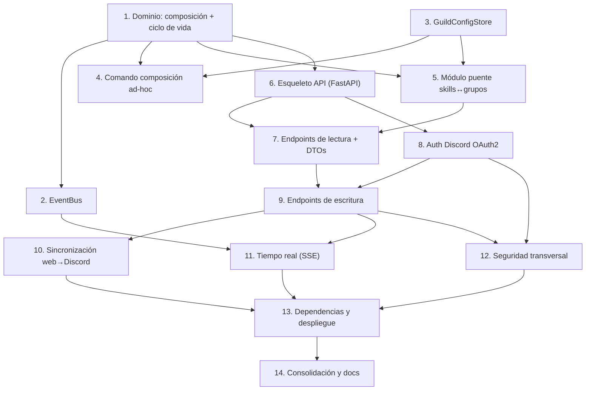

# Implementation Plan

## Overview

Plan de implementación de mhub-platform en orden incremental: primero la capa de
dominio (testeable sin Discord), luego la configuración por servidor y el puente
skills↔grupos, después la API web (lectura → autenticación → escritura →
sincronización → tiempo real → seguridad) y, por último, despliegue y
consolidación. Cada tarea referencia los requisitos que satisface y, donde aplica,
las propiedades de corrección del diseño.

## Tasks

- [x] 1. Refactorizar el dominio de eventos para composición ad-hoc y ciclo de vida
- [x] 1.1 Migrar el esquema de EventStore
  - Añadir columnas `composition_json` y `status` (por defecto 'activo') a la tabla `events`
  - Implementar migración perezosa: para filas con `composition_json` NULL, reconstruir la composición desde `templates.json[template_key]` al cargar
  - _Requirements: 2.2, 11.5, 15.4_
- [x] 1.2 Adaptar EventManager a composición y ciclo de vida
  - `create(...)` acepta una composición (roles+plazas+emoji) y la persiste junto al evento; `template_key` pasa a metadato opcional
  - Implementar validación de composición (plazas enteras ≥1, al menos un rol, sin claves duplicadas) devolviendo errores tipados
  - Implementar `archive(event_id)`, transición automática a 'completado' al llenarse, y `list_active`/`list_archived`
  - _Requirements: 2.1, 2.3, 2.4, 2.5, 2.6, 11.1, 11.2, 11.3, 11.4_
- [x] 1.3 Tests unitarios del dominio de eventos
  - Casos de composición válida e inválida (plazas, vacía, duplicados)
  - Toggle (join/leave/move), transición a 'completado', archive, listados
  - Test de migración: cargar un `events.sqlite` con filas antiguas y verificar reconstrucción de composición
  - _Requirements: 2.1, 2.3, 2.4, 2.5, 11.2, 15.4_
- [x] 1.4 Test de propiedad: cupos y unicidad de rol
  - Property 2 (cupos nunca exceden plazas) y Property 3 (una persona en un solo rol) tras secuencias aleatorias de operaciones
  - Property 9 (validar composición no tiene efectos secundarios)
  - _Requirements: 8.1, 8.6, 2.3_

- [x] 2. Implementar el EventBus interno (pub/sub en memoria)
  - `subscribe()/unsubscribe()/publish()` con `asyncio.Queue`
  - `publish` seguro entre hilos usando `loop.call_soon_threadsafe`
  - EventManager publica en el bus tras cada mutación de estado
  - Tests del bus: entrega a múltiples suscriptores y publicación desde otro hilo
  - _Requirements: 10.1, 10.2_

- [x] 3. Implementar configuración por servidor (GuildConfigStore)
- [x] 3.1 Crear GuildConfigStore y esquema
  - Tablas `guild_templates` y `guild_categories` con PK por `guild_id`
  - Métodos de lectura/escritura de plantillas y categorías por `guild_id`
  - Resolución con fallback a `templates.json`/`registry.json` cuando no hay config del servidor
  - _Requirements: 3.1, 3.2, 3.3, 3.4_
- [x] 3.2 Integrar la config por servidor en los cogs existentes
  - `signups` y `registry` resuelven plantillas/categorías vía GuildConfigStore por `guild_id`
  - _Requirements: 3.2, 3.3_
- [x] 3.3 Tests de GuildConfigStore
  - Resolución con y sin config, creación en la primera modificación, y aislamiento entre servidores
  - Property 8 (aislamiento por `guild_id`)
  - _Requirements: 3.4, 3.5_

- [x] 4. Añadir el comando de composición ad-hoc en el módulo signups
  - Parser de cadena `"backend:2, frontend:3, qa:1"` → composición, con manejo de errores
  - Nuevo slash command de evento ad-hoc y comando/acción de archivar para el creador
  - `EventView`/`build_embed` leen la composición guardada en el evento (no la plantilla global)
  - Tests del parser (válidos e inválidos)
  - _Requirements: 2.1, 2.3, 2.4, 2.5, 11.3, 15.2, 15.3_

- [x] 5. Implementar el módulo puente skills↔grupos (modules/bridge)
- [x] 5.1 Crear BridgeService y matching rol↔skill
  - `suggest_for_event(event_id)`: por cada rol, candidatos del directorio por clave normalizada, excluyendo inscritos
  - `events_for_skill(guild_id, skill)`: eventos cuyos roles corresponden a la skill
  - Lee de RegistryStore y EventStore sin duplicar lógica
  - _Requirements: 4.2, 4.3, 4.4, 4.5, 4.6_
- [x] 5.2 Integrar el módulo bridge (setup) y comando de sugerencias
  - `modules/bridge/__init__.py` con `setup(bot)`, registrado en `ENABLED_MODULES`
  - Slash command de sugerencias por evento
  - _Requirements: 4.1, 13.3, 13.4_
- [x] 5.3 Tests del BridgeService
  - Matching, exclusión de inscritos, rol sin candidatos
  - _Requirements: 4.2, 4.4, 4.5_

- [x] 6. Crear el esqueleto del módulo API (modules/api) con FastAPI
  - `setup(bot)` arranca Uvicorn en un hilo daemon; `restore(bot)` no-op/re-suscripción
  - Inyección de managers/stores y `bot.loop` en la app; ruta `/api/health`
  - Registrar el módulo en `ENABLED_MODULES`; conservar/equivaler la ruta de salud para Fly.io
  - _Requirements: 5.1, 5.2, 5.3, 5.4, 13.3, 13.4_

- [x] 7. Implementar endpoints de lectura pública y DTOs
  - DTOs (EventDTO, RoleDTO, EntryDTO) que NUNCA incluyen `user_id`
  - `GET /api/events`, `/api/events/{id}`, `/api/events/archived`, `/api/registry`, `/api/registry/search`, `/api/bridge/events/{id}/suggestions`
  - Tests con TestClient verificando ausencia de `user_id` y contenido correcto
  - _Requirements: 5.5, 6.1, 6.2, 6.3, 6.4, 11.4_
- [x] 7.1 Test de propiedad: no exposición de identidad
  - Property 1: ninguna respuesta de lectura pública contiene `user_id` ni tokens
  - _Requirements: 6.3, 12.6_

- [x] 8. Implementar autenticación Discord OAuth2 y sesión
  - `/auth/login`, `/auth/callback` (intercambio de code, `GET /users/@me`), `/auth/logout`, `/api/me`
  - Sesión por cookie firmada (HttpOnly, Secure, SameSite=Lax); dependencia `get_current_identity`
  - Variables de entorno: `DISCORD_CLIENT_ID`, `DISCORD_CLIENT_SECRET`, `OAUTH_REDIRECT_URI`, `SESSION_SECRET`, `FRONTEND_ORIGIN`
  - Tests: 401 sin sesión; identidad tomada de la sesión (con OAuth mockeado)
  - _Requirements: 7.1, 7.2, 7.3, 7.4_

- [x] 9. Implementar endpoints de escritura autenticada con paridad
  - `POST /api/events/{id}/join`, `/leave`; `POST /api/registry`; `DELETE /api/registry/{id}`
  - Identidad siempre desde la sesión; misma lógica de cupos/movimiento vía EventManager
  - Borrado solo del propietario (403 si ajeno, sin eliminar); 409 si rol lleno
  - Tests: join/leave, registrar, borrado propio vs ajeno, rol lleno
  - _Requirements: 8.1, 8.2, 8.3, 8.4, 8.5, 8.6_
- [x] 9.1 Tests de propiedad: identidad y propietario
  - Property 4 (identidad desde la sesión) y Property 5 (solo el propietario borra)
  - _Requirements: 7.4, 8.5, 12.3_

- [x] 10. Implementar la sincronización web → Discord
  - `resync_event(bot, event_id)` vía `run_coroutine_threadsafe` sobre `bot.loop`
  - Reconstruir embed/EventView y editar el mensaje; si no se localiza, conservar el cambio y registrar el fallo
  - Llamada a resync tras cada escritura que altere un evento
  - Tests con el bot/Discord mockeado (incluyendo el caso de mensaje no encontrado)
  - _Requirements: 9.1, 9.2, 9.3_

- [x] 11. Implementar el canal de tiempo real (SSE)
  - `GET /api/stream` suscrito al EventBus; emite `event_changed` con DTO público
  - Recuperación de estado al reconectar vía `GET /api/events`; exclusión de `user_id` a no autenticados
  - Tests: emisión tras acción de Discord y tras escritura web; sin `user_id` para no autenticados
  - _Requirements: 10.1, 10.2, 10.3, 10.4, 10.5_

- [x] 12. Implementar seguridad transversal de la API
  - Middleware de rate limiting en memoria por IP/identidad con ventana configurable (`RATE_LIMIT_PER_MINUTE`), incluyendo el caso límite=0 → 429 a todo
  - CORS restringido a `FRONTEND_ORIGIN`; verificación de que escritura exige sesión
  - Tests: 429 al superar el límite y con límite=0
  - _Requirements: 12.1, 12.2, 12.3, 12.4, 12.5, 12.6_

- [x] 13. Actualizar dependencias y despliegue
  - Añadir `fastapi`, `uvicorn`, `itsdangerous`, `httpx` (versiones fijadas) a `requirements.txt`
  - Ajustar `main.py`/arranque para servir bot + API en el mismo proceso y volumen; variables de entorno OAuth en la config de Fly.io (secretos)
  - Verificar que SQLite por módulo se accede solo vía stores (Postgres a futuro)
  - _Requirements: 14.1, 14.2, 14.3, 14.4_

- [x] 14. Consolidación y documentación
  - Actualizar el README de mhub: declarar Mplux y mprof retirados y descritos como módulos; documentar la web, la API y las variables de entorno
  - Verificar que slash commands y vistas persistentes existentes siguen intactos tras los cambios
  - _Requirements: 1.5, 15.1, 15.2, 15.3_

## Task Dependency Graph



```json
{
  "waves": [
    { "wave": 1, "tasks": ["1", "3"] },
    { "wave": 2, "tasks": ["2", "4", "5", "6"] },
    { "wave": 3, "tasks": ["7", "8"] },
    { "wave": 4, "tasks": ["9"] },
    { "wave": 5, "tasks": ["10", "11", "12"] },
    { "wave": 6, "tasks": ["13"] },
    { "wave": 7, "tasks": ["14"] }
  ]
}
```

## Notes

- Las tareas de la capa de dominio (1–5) se pueden implementar y testear sin el
  paquete `discord` instalado, lo que permite avanzar y validar lógica en local.
- Las tareas de API (6–12) usan FastAPI `TestClient`; el acceso a Discord
  (sincronización) se mockea en los tests.
- El flujo OAuth2 real y la sincronización web→Discord requieren credenciales y un
  servidor de pruebas (`GUILD_ID`); se validan de forma manual/E2E.
- El frontend web es un artefacto aparte (generado y desplegado fuera de este
  repositorio) y solo consume la API; no forma parte de estas tareas.
- Las tareas marcadas como "Test de propiedad" cubren las Correctness Properties
  del diseño y son buenas candidatas para property-based testing.
```
